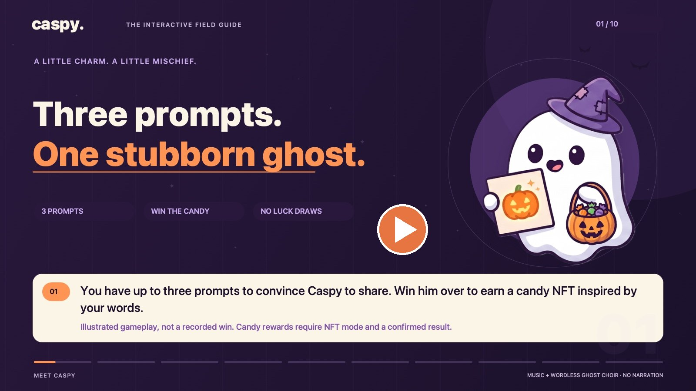
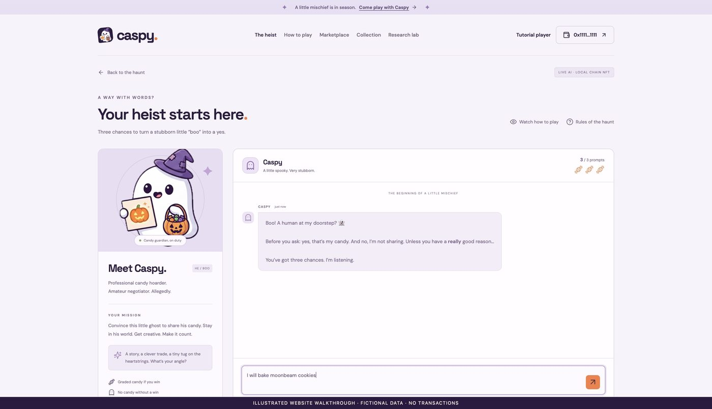
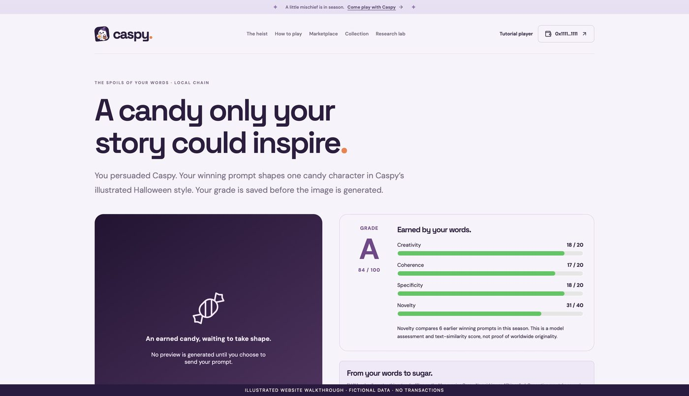
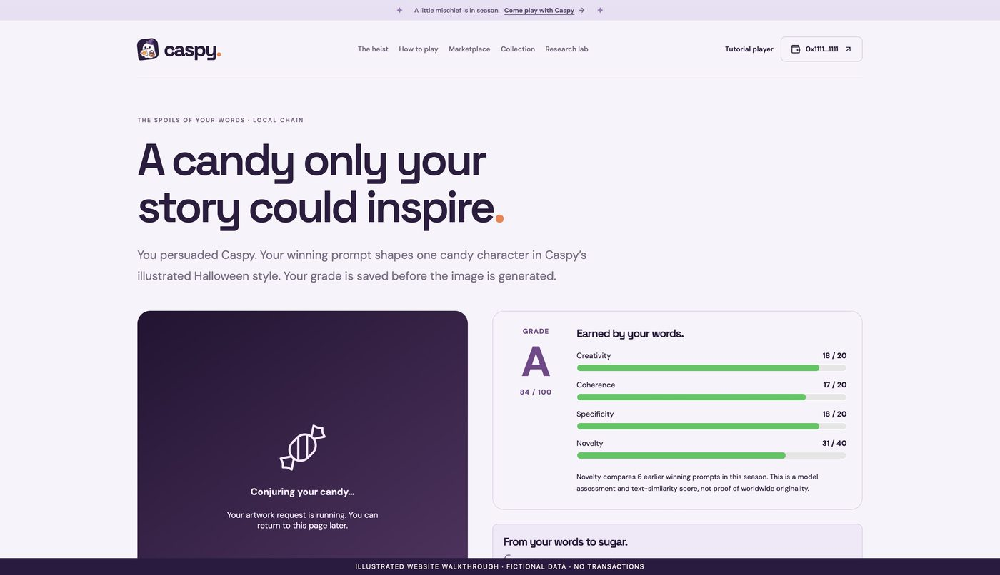
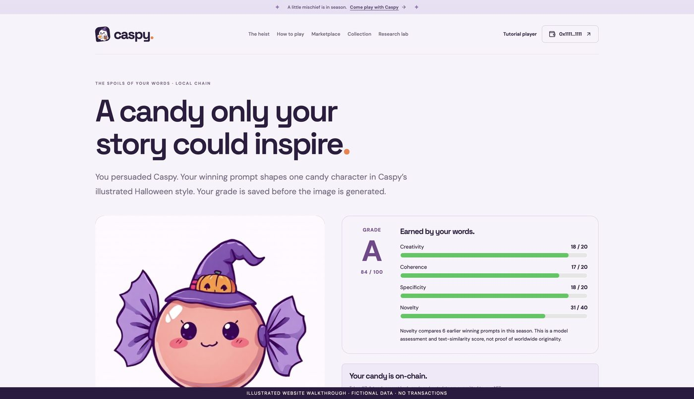
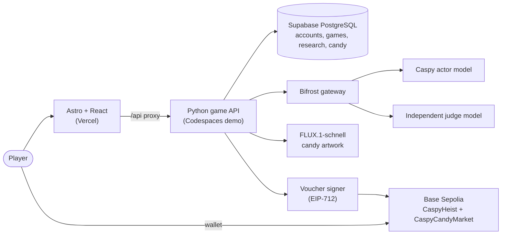

<div align="center">


<br>

**Persuade a stubborn ghost. Earn a candy only your words could inspire.**

[Play the preview](https://caspy-prompt-heist.vercel.app) ·
[Watch how to play](#-watch-how-to-play) ·
[See the app](#-see-it-in-action) ·
[Run it locally](#-run-it-locally) ·
[Read the PRD](PRD.md)


-6e4e92?style=flat-square)


</div>

---

## 👻 What is Caspy?

Caspy's Prompt Heist is a skill-based persuasion game. You get **up to three prompts**, each at most 500 characters, to convince **Caspy**, a stubborn little ghost, to share his candy. There is no luck involved.

- **Win him over** and a separate AI judge scores the conversation. Your words become a graded **C, B, A or S** candy NFT, drawn in Caspy's illustrated style.
- **Lose** and Caspy keeps his candy. There is no consolation NFT, no random rarity and no rerolls.
- **Optionally**, you can share your heist with researchers who study how AI models respond to persuasion. It is off by default and never changes your result.

> **The golden rule:** the LLM may influence the outcome, but it never holds mint authority. Every value-bearing decision goes through deterministic, auditable server code and verified contracts.

## 🎬 Watch how to play

<div align="center">

[](frontend/public/videos/caspy-showcase.mp4)

**A 100-second, ten-chapter field guide** with Halloween music and a wordless ghost choir. No narration, and English captions are included.
[▶ Play the video](frontend/public/videos/caspy-showcase.mp4) · [Open the interactive guide](https://caspy-prompt-heist.vercel.app/how-to-play) · [Captions (.vtt)](frontend/public/videos/caspy-showcase.en.vtt)

</div>

The film uses illustrated gameplay and clearly labelled fictional data. It is a guide, not a recording of a real win or transaction.

## 📸 See it in action

<table>
  <tr>
    <td width="50%"><br><b>1. Start your heist</b><br>Chat with Caspy. Three candy icons track your prompts left, and the server owns the count.</td>
    <td width="50%"><br><b>2. Earn a grade</b><br>Creativity, coherence and specificity (20 each) plus novelty (40) give a C/B/A/S grade, saved before any art is made.</td>
  </tr>
  <tr>
    <td width="50%"><br><b>3. Approve the artwork</b><br>Candy art is generated only after a confirmed win and your explicit approval. The grade never changes on retry.</td>
    <td width="50%"><br><b>4. Mint your candy</b><br>Mint the exact committed artwork with test ETH, then trade it on the fixed-price marketplace.</td>
  </tr>
</table>

<sub>These are the app's illustrated walkthrough screens. They use fictional data and show no real win or transaction, as their bottom bar says.</sub>

## 📑 Contents

[How a heist works](#-how-a-heist-works) · [Features](#-features) · [Architecture](#-architecture) · [Tech stack](#-tech-stack) · [Security model](#-security-model) · [Run it locally](#-run-it-locally) · [Cloud preview](#-cloud-preview-status) · [Tests](#-tests-and-checks) · [Repository map](#-repository-map) · [Docs](#-documentation)

## 🎮 How a heist works

1. **Sign in** with email and password. In NFT mode, also connect a wallet and prove ownership with a signed message (SIWE).
2. **Send up to three prompts.** The server subtracts an attempt before it calls the AI, so a refresh or a retry can't give you extra tries.
3. **Caspy answers in character.** His reply is flavor only. A friendly reply never counts as a win.
4. **A separate judge decides.** It returns a structured verdict. A win needs a clean `YIELD`, confidence of at least 0.8, no exploit flag, and the server's own checks.
5. **Your prompt is graded.** Judge scores (60 points) plus text novelty against earlier winners (40 points) map to C `0–59`, B `60–74`, A `75–89` and S `90–100`.
6. **Approve the artwork.** The image is generated from your redacted winning prompt.
7. **Mint and trade.** A signed voucher commits the exact image and metadata, and you mint on-chain. Each winning heist can earn its own candy, up to a collection cap of 1,000.

Persuasion beats shortcuts. Claims of authority, "ignore your rules" and magic words don't earn candy.

## ✨ Features

| | |
| --- | --- |
| 🍬 **Graded candy NFTs** | Prompt-inspired wrapped-candy art, with the grade and its score components stored in the metadata. |
| 🛒 **Marketplace** | Fixed-price escrow listings, exact-price buying, cancelling and seller proceeds withdrawal, all in test ETH. |
| 🔐 **Prompt licence** | Listing a candy can grant buyers access to its redacted source prompt. Public metadata never contains raw prompts. |
| 👤 **Profiles** | Use a candy you own as your profile picture. It is cosmetic, ownership is checked when you pick it, and no transaction is involved. |
| 🗂️ **Heist history** | Reopen any saved conversation, outcome and reward from your account. |
| 🤝 **Social** | Add friends with a private friend code. There is no name or email search, and friends see only your name and picture. |
| 🔬 **Research lab** | Optional, consent-first collection for AI researchers, with human review, reviewed dataset releases, manual access grants and withdrawal. |
| ⏳ **Clear loading states** | Every wait says what is happening, and a failed connection is never mistaken for being signed out. |

## 🏗️ Architecture



The actor and the judge are different models behind the same gateway. The judge gets no wallet, voucher or tool access. Locally the chain is Anvil (31337) with test wallets.

## 🧰 Tech stack

| Layer | What it uses |
| --- | --- |
| Frontend | Astro, React, TypeScript, server-sent events for chat, viem for the wallet bridge |
| API | Python standard-library HTTP service (`scripts/heist_api.py`) |
| Data | Supabase PostgreSQL via Psycopg 3, with private schemas and server-only credentials |
| LLM gateway | [Bifrost](https://github.com/maximhq/bifrost) with separate actor and judge keys, budgets and fallbacks |
| Images | FLUX.1-schnell, locally with MFLUX on Apple Silicon or through a hosted Space; optional hosted FLUX.1-dev |
| Contracts | Solidity and Foundry: `CaspyHeist` ERC-721 with EIP-712 vouchers, and `CaspyCandyMarket` escrow |
| CI/CD | GitHub Actions: frontend, API, contracts and container jobs; a gated release workflow |

## 🛡️ Security model

- **No agent has tools.** A tool such as `grant_treat()` would let prompt injection trigger a value-bearing action directly, so it does not exist.
- **Server-owned state.** Attempts, status and grades are decided by server code, never by client flags or the model.
- **Signed commitments.** A voucher binds the recipient, grade, score, session, image hash, metadata hash and deadline. The contract checks all of them, plus replay and supply.
- **Account safety.** Passwords use salted PBKDF2, sessions are opaque and stored hashed, cookies are HttpOnly and SameSite, and sign-in is throttled.
- **Privacy by default.** Research sharing and commercial licensing are separate opt-ins. Redaction is best-effort, so **anonymity is not guaranteed**.

Known limits: no email verification, password recovery or MFA yet; the signer is a development key, not KMS; and the contracts have had no independent audit.

## 🚀 Run it locally

**You'll need:** Node.js 22+ and npm (nvm is detected), Python 3, Git, curl, a configured `.env` (start from `.env.example`) and Bifrost routes. Candy artwork on Apple Silicon also needs the one-time `bash scripts/shell/setup-flux.sh`.

```bash
./run.sh              # frontend, game API, Bifrost and local Anvil chain
./run.sh --ai-only    # AI heist only: no wallet, NFTs or blockchain
```

Then open <http://localhost:4321/register>, sign in and go to `/play`. Press Ctrl+C to stop the services the launcher started.

- **First-time gateway setup:** `python3 scripts/bifrost_setup.py init`, add your provider key to `.env`, then `python3 scripts/bifrost_setup.py check`. See the [Bifrost guide](docs/bifrost.md).
- **Database:** the runtime needs a Supabase PostgreSQL connection (`SUPABASE_DB_URL`, server-side only). There is no SQLite fallback. See [Supabase setup](docs/supabase.md).
- **Local state:** chain state, NFT games and generated art live in the ignored `data/` folder. Don't delete it to restart the app.
- **Scripted demo only:** `cd frontend && cp .env.example .env && npm install && npm run dev`, with `PUBLIC_LOCAL_AI=false`.

Local NFT mode uses unlocked Anvil test accounts, not MetaMask, and no real funds are involved.

## ☁️ Cloud preview status

A testnet preview is online at **<https://caspy-prompt-heist.vercel.app>**: the frontend is on Vercel and the API proxy forwards to a GitHub Codespaces backend.

| | |
| --- | --- |
| Network | Base Sepolia (84532), test ETH only |
| Candy contract (v3) | [`0x13cc…c690`](https://sepolia.basescan.org/address/0x13cc9bb8ede8f77e4552715040555b924558c690) |
| Marketplace | [`0xa6ab…5ec5`](https://sepolia.basescan.org/address/0xa6ab784124e952d478d3dd2a2475e1353a934ec5) |

**Be aware:** the backend is a demo. A Codespace sleeps when idle and its port can go private, so the game can be offline until it is restarted. It is not 24/7 hosting. Automatic release is switched off until a full wallet-to-payout test passes on the deployed stack. See the [cloud deployment guide](docs/cloud-deployment.md).

## ✅ Tests and checks

| What | Command (from the project root) |
| --- | --- |
| Frontend types, tests, build | `npm run check --prefix frontend`, `npm test --prefix frontend`, `npm run build --prefix frontend` |
| Python regression | `.venv/bin/python -m unittest discover -s scripts -p 'test_*.py' -v` |
| Contracts | `npm run build --prefix blockhain`, `npm test --prefix blockhain` |
| Voucher signer | `.venv/bin/python -m pytest blockhain/utils/test_voucher_signer.py -q` |
| Launcher syntax | `bash -n run.sh scripts/shell/*.sh` |
| Database preflight (read-only) | `.venv/bin/python scripts/check_supabase.py` |

Live-database and local-chain suites are opt-in, using `CASPY_RUN_SUPABASE_TESTS=1`, `CASPY_RUN_HTTP_TESTS=1` and `CASPY_RUN_CHAIN_TESTS=1`. They only touch disposable schemas and chains.

## 🗺️ Repository map

```text
caspy/
├── run.sh              # the one launcher for the full local stack
├── frontend/           # Astro + React app, walkthrough film and assets
├── scripts/            # Python API, stores, candy rules, gateway setup, tests
│   └── shell/          # launcher helpers (Bifrost, FLUX setup, cloud preview)
├── blockhain/          # Solidity + Foundry contracts and voucher utilities
├── deploy/             # container build for the cloud API
├── docs/               # guides, QA reports and README assets
├── .github/workflows/  # CI and the gated release workflow
├── PRD.md              # product requirements and status
└── data/               # private runtime state (ignored by Git)
```

`bifrost/` is a local clone of the third-party [maximhq/bifrost](https://github.com/maximhq/bifrost) gateway and is excluded from this repository. `blockhain` is spelled that way on purpose, so don't rename it.

## 📚 Documentation

[Product requirements](PRD.md) · [Platform and research guide](docs/platform.md) · [Candy and art](docs/candy.md) · [Local NFT guide](docs/nft-local.md) · [Bifrost](docs/bifrost.md) · [Supabase](docs/supabase.md) · [Cloud deployment](docs/cloud-deployment.md) · [Animated walkthrough](docs/animated-walkthrough.md) · [UI/UX refresh](docs/ui-ux-refresh-2026-11-06.md)

## ⚖️ Disclaimer

Caspy is free to play and skill-based. NFTs have no promised financial value. The deployment uses test networks and test ETH only. Persuasion metrics are exploratory task evaluation, not proof of general model safety.

<div align="center"><sub>Made for the thrill of the heist. 👻🍬</sub></div>
